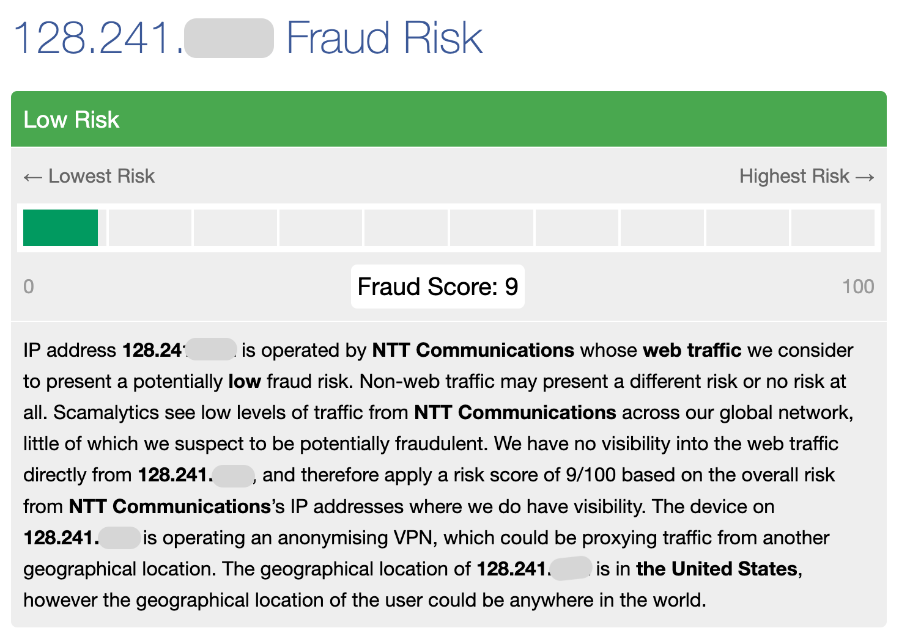
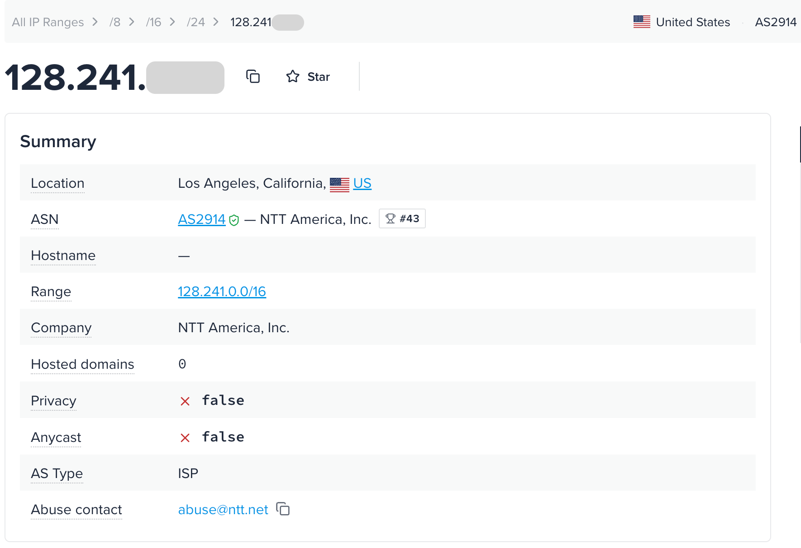
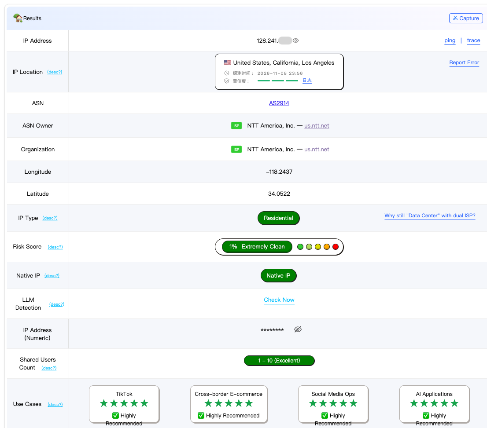

# Scamalytics and ipinfo Explained: A Second Opinion on IP Reputation

> **Who this is for:** Anyone who has already checked ping0 or IPQS and wants an independent second source, plus local businesses and testers who need to verify an IP's type, ownership, and location.
> **What you'll learn:** What every field on Scamalytics and ipinfo reports means, which items each one is good for double-checking, and how a full multi-tool cross-check plays out on a real IP.
> **Reading time:** about 15 minutes
> **Series:** Part 7 of 11 · Core path: fields

---

## Key takeaways

- For a second look at reputation history, check Scamalytics' `Fraud Score` (0–100), then see whether the IP hits any of 5 public blocklists, including Spamhaus and Firehol.
- To verify what kind of network the IP is on and where it shows up, check ipinfo's ASN type (ASN stands for Autonomous System Number) and location data. ipinfo also shows whether it detected a VPN, proxy, hosting, or residential proxy.
- If you've already checked ping0 or IPQS, pick the item you want to confirm first, then decide which tool to recheck it with.
- Scamalytics notes on its page that its proxy flags come from IP2Proxy. When the two show the same proxy flag, it counts as one piece of evidence.
- In this article's case study, ping0 shows Residential and ipinfo's ASN type is `ISP` (internet service provider), but Scamalytics shows `Server: Yes`. We'll use the original reports to see what else you can check.

---

## Why cover these two tools together

After checking ping0 or IPQS, the most common question is: "Which tool should I use for a second opinion?"

| Dimension you want to recheck | Recommended tool | Why |
|---|---|---|
| ③ Reputation history | **Scamalytics** | Uses different data sources from IPQS and also summarizes several public blocklists |
| ① Type authenticity, ② geographic consistency | **ipinfo** | Clear ASN type, privacy detection, and location data, and it's one of the data sources many websites query behind the scenes |
| ④ Exclusivity | Both detect residential proxies | Shows whether the IP has been identified as part of a residential proxy network |

Both offer free web lookups and an API.

---

## Scamalytics, field by field

*This screenshot shows the score summary. The IP address is partially masked, and no lookup date is shown. The page gives a score of 9 while also flagging an anonymizing VPN in its description. Read the risk score and the proxy flags separately.*

### 1. Fraud Score and risk level ★★★

**What it is:** Scamalytics' `Fraud Score` runs from 0 to 100. The higher the score, the higher the risk it sees. The page also shows a risk level, such as `Low Risk`.

The Scamalytics website doesn't publish its tier details. According to its threat intelligence integration documentation, the tiers are: 0–25 low risk, 26–50 medium risk, 51–75 high risk, and 76–100 very high risk.

**In plain terms:** It's a credit score from a different credit bureau, except lower is better.

**What it means for you:**
- For a static residential IP, aim for the low-risk range.
- Third-party sources say Scamalytics' scoring considers feedback from a wider area, such as the IP's subnet and ASN. So an IP with no bad record of its own can still score high because of its "neighbors." That's a third-party claim, but it's a useful reminder: **when one source scores high, read it alongside other sources.**
- Scamalytics' score uses a different scale from IPQS and ping0, and they can't be converted.

### 2. Operator ★★

| Field | Meaning |
|---|---|
| Hostname | The hostname (from reverse DNS); shows n/a if there isn't one |
| ASN | Autonomous System Number |
| ISP Name | The network provider's name |
| Organization Name | The operating organization's name, which may differ from the ISP |
| Connection type | Connection type; many IPs show n/a |

**What it means for you:** Use these to check ownership against the ASN and ISP information on other tools. Connection type is often empty, so don't judge the type from it.

### 3. Location ★★

**What it is:** Country, state / province, district / county, city, postal code, and coordinates. The page notes that its IP address data partner is DB-IP.

**What it means for you:** It can serve as one more geolocation database in your "majority agrees" check. Note that its city may differ slightly from other databases (for example, in this article's case study it shows East Los Angeles, which borders the City of Los Angeles).

### 4. Datacenter ★★

**What it is:** Whether the IP is in a datacenter: Yes, No, or Unknown.

**What it means for you:** `Yes` means Scamalytics labels it a datacenter IP. If you see `Unknown`, mark it as pending and check other sources.

### 5. External Blacklists ★★★

**What it is:** Whether the IP appears on 5 public blocklists / datasets:

| Blocklist | In brief |
|---|---|
| Firehol | An aggregate blocklist built from several public threat IP lists |
| IP2ProxyLite | IP2Proxy's free proxy IP database |
| IPsum | A list of malicious IPs ranked by how many threat lists include them |
| Spamhaus | A well-known anti-spam and malicious network blocklist |
| X4Bnet Spambot | A list of spambot IPs |

**In plain terms:** Like checking whether someone shows up on a few public watch lists.

**What it means for you:**
- Ideally, a static residential IP shows No on all of them.
- A hit on a threat list such as Spamhaus, Firehol, or IPsum means the IP has been used for malicious activity. For account-based work, treat it as red.
- A hit on IP2ProxyLite means it's been identified as a proxy, which is a signal about exclusivity / type.

### 6. Proxies ★★

**What it is:** A set of yes / no flags: Anonymizing VPN, Tor Exit Node, Server, Public Proxy, Web Proxy, and Search Engine Robot. The page notes that the proxy data comes from IP2Proxy.

**What it means for you:**
- Yes on VPN, Tor, Public Proxy, or Web Proxy is a clear negative signal for a static residential IP.
- Scamalytics' public pages don't explain how `Server` is assigned. In IP2Proxy's usage type categories, `DCH` covers datacenters, web hosting, and transit networks. The two may be related, but public sources don't make clear exactly how they map to each other.
- Because the data comes from IP2Proxy, **when Scamalytics and IP2Proxy agree on these flags, they don't count as two independent sources.**

### 7. Residential Proxy ★★★

**What it is:** Whether the IP belongs to a residential proxy network.

**In plain terms:** The question isn't "Are you residential?" It's "Are you a residential connection being rented out as a proxy?"

**What it means for you:** `Yes` means Scamalytics believes the IP is part of a residential proxy network. Before you buy, check whether your team has a requirement for this field, then judge by what you agreed on.

### 8. Rule-of-thumb ranges for Scamalytics

| Field | 🟢 Green | 🟡 Yellow | 🔴 Red |
|---|---|---|---|
| Fraud Score | Low risk (0–25) | Medium risk (26–50) | High risk or above (> 50) |
| External blocklists | No hits | Only IP2ProxyLite | A hit on a threat list such as Spamhaus, Firehol, or IPsum |
| VPN / Tor / Public Proxy / Web Proxy | All No | — | Any Yes |
| Server / Datacenter | Both show No | One shows Unknown, or only Server shows Yes; check with another source first | Several sources label it datacenter |
| Residential Proxy | No | — | Yes (account-based work) |

These are rules of thumb, not official Scamalytics standards.

---

## ipinfo, field by field

*Use this screenshot to match up ipinfo's summary fields. The IP address is partially masked, and no lookup date is shown.*

ipinfo's web lookup shows fairly complete information. The free API returns basic fields (IP, hostname, city, region, country, coordinates, organization, postal code, time zone); privacy detection and similar fields require the corresponding paid data.

### 1. Basic and location fields ★★

| Field | Meaning |
|---|---|
| hostname | Hostname (from reverse DNS) |
| city / region / country | City, state / province, country |
| postal | Postal code |
| loc | Coordinates |
| timezone | Time zone |
| org | ASN number and name (for example, "AS number + company name") |

**What it means for you:** ipinfo is one of the major geolocation databases in your "majority agrees" check. Use the time zone to check whether your device's time zone setting matches the IP.

### 2. ASN type (AS Type) ★★★

**What it is:** The network type ipinfo assigns to the ASN. Common values are `ISP`, `Hosting`, `Business`, and `Education`.

**In plain terms:** This isn't about where the person works. It's about what their employer does.

**What it means for you:**
- Ideally, a static residential IP shows ISP. Hosting means the network is mainly in the hosting business, which doesn't match what you'd expect from residential.
- This ipinfo field tells you what category the network falls in. ping0's IP Type is based on its read of how the IP range is used. If the two disagree, see the conflict cases in Part 4.

### 3. Route / Range ★★

**What it is:** The routing prefix the IP belongs to (for example, a /18) and the range of the block.

**What it means for you:** When an agency buys in bulk, this helps show whether several IPs belong to the same block (Part 10).

### 4. Privacy / Anonymization ★★★

**What it is:** A set of detection results: VPN, Proxy, Tor, Relay (for example, some browsers' privacy relay services), Hosting, and Residential Proxy. If it detects a related service, it sometimes shows the provider's name.

**What it means for you:**
- Ideally, a static residential IP shows "not detected" for all of them.
- **Hosting detected:** ipinfo thinks this is a hosting / datacenter IP, which doesn't match what you'd expect from residential.
- **Residential Proxy detected:** It's been identified as part of a residential proxy network. For account-based work, take this signal seriously.

### 5. Company ★

**What it is:** The name and type of the company the IP belongs to.

**What it means for you:** Helps confirm ownership; it usually matches or relates to the ASN owner.

### 6. Abuse contact ★

**What it is:** Contact details for abuse complaints about this IP range.

**What it means for you:** Most users won't need it, but it can help show which organization manages the range.

### 7. Hosted domains ★★

**What it is:** Domains that resolve to this IP.

**What it means for you:** Residential IPs generally don't host many websites. If an IP hosts lots of domains, it's very likely a server, not a residential IP.

### 8. Anycast ★

**What it is:** Whether the address is anycast (the same IP announced from several locations at once, common for public DNS and CDNs).

**What it means for you:** A residential IP shouldn't be anycast. If it shows as anycast, it isn't the residential IP you think it is.

### 9. Rule-of-thumb ranges for ipinfo

| Field | 🟢 Green | 🟡 Yellow | 🔴 Red |
|---|---|---|---|
| ASN type | ISP | Business, Education (depends on your work) | Hosting, with most other tools also saying datacenter |
| VPN / Proxy / Tor / Relay | None detected | — | Any detected |
| Hosting | Not detected | — | Detected |
| Residential Proxy | Not detected | — | Detected (account-based work) |
| Location | Agrees with most other major databases | City differs but is in the same metro area | Country doesn't match |
| Hosted domains / Anycast | None / No | — | Many hosted domains / anycast |

These are rules of thumb, not official ipinfo standards.

---

## Case study: cross-checking one IP across several tools

Here's a full cross-check on a real IP (masked as 207.55.x.x).

### Step 1: Collect each tool's results

| Dimension | ping0 (2026-11-09) | ipinfo (2026-11-11) | Scamalytics (2026-11-11) |
|---|---|---|---|
| Location | US / California / Los Angeles, full confidence | US / California / Los Angeles, ZIP 90022 | US / California / East Los Angeles |
| Type | Residential | ASN type: ISP; hosting not detected | Datacenter: Unknown; **Server: Yes** |
| Reputation | Risk Score 1% (extremely clean) | — | Fraud Score 9 (low risk); no hits on any of the 5 blocklists |
| Exclusivity | Shared Users Count 1–10 | VPN, proxy, Tor, relay, and residential proxy all not detected | VPN, Tor, public proxy, web proxy, and residential proxy all No |
| Native / broadcast | Native IP | — | — |

*Use this ping0 screenshot to match up the fields. The probe time shown on the page differs from the table above; the case study goes by the records in the table.*

*Use this screenshot to match up `fraud_score`, `proxy`, and `recent_abuse`. The address in the screenshot is partially masked and can't be matched to the case study address above, so read this result on its own.*

### Step 2: Judge each dimension

| Dimension | Assessment | Light |
|---|---|---|
| ② Geographic consistency | All three tools place it in the Los Angeles metro area, and the country matches; native IP | 🟢 |
| ③ Reputation history | Two independent sources, ping0 and Scamalytics, both show low risk, with no blocklist hits | 🟢 |
| ④ Exclusivity | ping0 Shared Users Count shows 1–10, and neither ipinfo nor Scamalytics detected a proxy. Confirming it's dedicated still depends on the purchase terms | 🟢 (items checked) |
| ① Type authenticity | ping0 shows Residential, ipinfo's ASN type is `ISP` with no hosting detected, and Scamalytics shows `Server: Yes` | 🟡 |

### Step 3: Track down the reason for the disagreement

The only disagreement is Scamalytics' "Server: Yes." We ran two checks:

1. **Check a neighboring IP in the same range.** We looked up another IP in the same `/24`. It also showed `Server: Yes`, a `Fraud Score` of 9, and `Datacenter: Unknown`.
2. **Check where the flag comes from.** Scamalytics' proxy flags come from IP2Proxy. In IP2Proxy's usage type categories, `DCH` covers datacenters, web hosting, and transit networks. Public sources don't make clear whether Scamalytics uses this category to assign `Server`.

All we can confirm for now is that the two addresses return the same results. Whether the flag is assigned per IP or per range needs more evidence. Mark type as yellow for now.

### Step 4: Reach a verdict

- **Overall:** The items checked for location, reputation history, and exclusivity are green; type is yellow for now.
- **For account-based work:** If your buying standard allows a yellow on this item, keep the IP as a candidate and finish checking the remaining items.
- **If your team or client relies mainly on Scamalytics / IP2Proxy,** first confirm whether the agreed standard can accept `Server: Yes`.
- **Last step:** Add the IPQS results and check ping0's ASN / organization / registration country history tables to confirm long-term stability.

Record each tool's results separately. Before you buy, confirm whether this disagreement affects the standard you agreed on with your team.

---

## Quick reference: the recheck process

1. Run the first round of checks with ping0 or IPQS (Parts 5 and 6).
2. Recheck reputation with **Scamalytics:** the score, blocklists, and proxy flags.
3. Recheck type and ownership with **ipinfo:** ASN type, privacy detection, and location.
4. When results disagree, first find out what each field measures and whether they share a data source. If you haven't found the reason yet, write down the disagreement.
5. Reach a verdict with the traffic-light method from Part 4, and note the date.

---

## Which fields matter for your use case

| Reader | Scamalytics focus | ipinfo focus |
|---|---|---|
| A: Social media managers running accounts long-term | Blocklists, Residential Proxy | Privacy detection (especially residential proxy and hosting) |
| B: Cross-border e-commerce sellers | Fraud Score, blocklists | ASN type, country / state |
| D: Ad account managers and media buying teams | Fraud Score, blocklists | Privacy detection |
| C: Local businesses serving a specific city | Location (as one more geolocation database) | City, postal code, time zone |
| E: Agencies and overseas VA teams | Proxy flags (bulk checks) | ASN, Route / Range (to see subnet spread) |
| F: Testers running long-term checks in a fixed region | — | City, ASN type (recorded on every test) |

---

## FAQ

**Q: Scamalytics shows "Server: Yes." Can I still use the IP?**
First see how other IP checkers label it. If only Scamalytics shows `Server: Yes`, mark type as yellow for now and decide according to your team's buying requirements. If several sources label it datacenter, treat it as red.

**Q: Which is more accurate, Scamalytics or IPQS?**
Neither is simply more accurate. They use different data sources, which makes them good second opinions for each other. When one runs high and the other is normal, check for recent abuse and blocklist hits.

**Q: ipinfo shows the ASN type as ISP. Does that mean it's home broadband?**
ISPs also sell business lines and datacenter services. Check ping0's IP Type first. If you must have real home broadband, ask the vendor to explain where the exit is connected.

**Q: ipinfo detected a Residential Proxy. What now?**
That means ipinfo labels the IP a residential proxy. If your team agreed before buying that this field must show "not detected," ask for a replacement as agreed.

---

## What to read next

- [Part 5: ping0 report, field by field](05-ping0-field-guide.md)
- [Part 6: IPQualityScore report, field by field](06-ipqualityscore-field-guide.md)
- [Part 4: IP checkers compared](04-ip-checker-platforms.md): cross-checking and the traffic-light method
- [Part 9](09-scenarios-accounts-stores.md) and [Part 10](10-scenarios-regions-teams.md): decide by use case

---

> This is Part 7 of *The Static Residential Proxy Buyer's Guide*, written by the [GetIPProxy](https://getipproxy.com/) team. Field definitions for third-party tools follow each tool's official pages. The real test data in the case study was collected November 9–11, 2026. Test results change over time.

**Sources**
- [Scamalytics IP lookup](https://scamalytics.com/ip/)
- [Scamalytics threat intelligence integration guide (ThreatQ)](https://helpcenter.threatq.com/assets/PDFs/Integrations/Scamalytics_Action_Guide_v1.0.0.pdf)
- [IP2Proxy database documentation (proxy types and usage types)](https://www.ip2location.com/database/px11-ip-proxytype-country-region-city-isp-domain-usagetype-asn-lastseen-threat-residential-provider/)
- [ipinfo IP lookup](https://ipinfo.io/)
