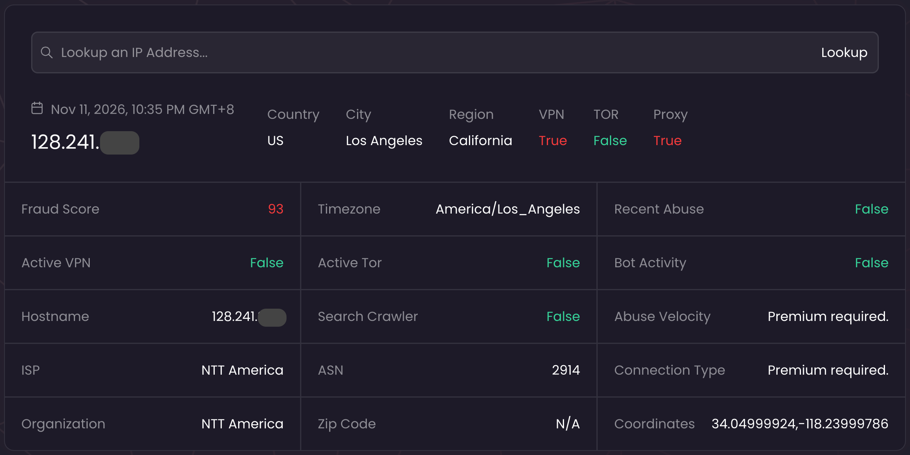

# IPQualityScore 检测报告逐字段解读：fraud_score、proxy、recent_abuse 到底怎么看

> **适合谁读**：用 IPQualityScore（IPQS）检测静态住宅 IP 的人，尤其是跨境电商、广告投放人员，以及需要用 API 批量检测的团队
> **读完你能**：看懂 IPQS 报告上每个字段的含义；按正确的顺序读报告；结合自己的业务判断一个 IP 能不能用
> **阅读时间**：约 15 分钟
> **系列位置**：第 06 篇 · 主线的"字段"部分

---

## 先说结论

- IPQS 网页把欺诈分（`fraud_score`）分为 0–39 低风险、40–75 可疑、76–84 有风险、85–89 高风险、90–100 欺诈。本系列选购时以 0–39 为低风险区间，再结合其他字段判断。
- 先看报告有没有显示 `recent_abuse`、`proxy`、`tor` 等字段。逐项看是 `true` 还是 `false`，再看分数。
- `recent_abuse=true` 表示 IPQS 报告了近期确认的滥用。给账号、店铺或支付业务选 IP 时，看到这一项就按红灯处理。
- `mobile` 看的是浏览器 User-Agent。字段留空或显示「需要付费」，就记作没查到。同一个 IP 用不同参数查，分数也可能不同。
- IPQS 是第三方评估，不是任何平台的内部评分，也不测量网速。看完 IPQS，建议再用 ping0 或 Scamalytics 复核一次。

---

## 一、IPQS 是什么，适合回答什么问题

IPQualityScore 是一家欺诈检测服务商，被大量网站用于注册、登录、交易环节的风险识别。它的数据主要来自在 150 多个国家部署的**蜜罐和欺诈陷阱网络**，持续捕获虚假注册、账号盗用、机器人、代理和 VPN 等流量。

它提供免费的网页查询（有月度免费额度），也提供 API。网页查询和 API 返回的字段不完全相同，部分字段（官方标注为 Enterprise Data Point）需要更高级别的付费方案。

**适合回答**：这个 IP 有没有被滥用？最近有没有？是否被识别为代理、VPN 或 Tor？在一个欧美主流风控服务商眼里风险有多高？

**不适合回答**：这个 IP 是不是"实际用在"家庭宽带（ping0 按实际用途标注，口径不同）；原生还是广播；网速快不快。

*图中查询时间为 2026-11-11 22:35（GMT+8），IP 地址已部分遮挡。欺诈分是 93，Proxy 和 VPN 都是 True，Recent Abuse 是 False。Connection Type 和 Abuse Velocity 显示需要付费，读报告时把这两项记作没查到。*

---

## 二、先看懂分数：fraud_score 的官方分档

IPQS 的欺诈分（`fraud_score`）是 0–100。分数越高，IPQS 评估的风险越高。下面是它在网页上公布的分档。

| fraud_score | 风险等级 | 官方说明 |
|---|---|---|
| 0–39 | 低风险 | 几乎没有欺诈或滥用的证据 |
| 40–75 | 可疑 | 存在一些风险迹象，可能需要进一步审查 |
| 76–84 | 有风险 | 可疑活动或滥用的可能性较高 |
| 85–89 | 高风险 | 存在较强的欺诈相关证据 |
| 90–100 | 欺诈 | 欺诈、滥用、自动化或恶意活动的可能性非常高 |

IPQS 的网页说明提到，大多数正常用户的 IP 欺诈分低于 40。API 文档把 75 分及以上视为可疑，建议对 90 分及以上的流量标记或拦截。选购 IP 时，可以按本系列的红黄绿灯经验表判断。

**为什么你查到的分数和别人不一样？**

- IPQS 的 API 支持 `strictness`（严格程度）参数，官方说明较高的严格程度处理更深入，但误报也可能更多；还可以传入浏览器 User-Agent、语言等信息一起评估；
- 网页查询和不同参数的 API 查询，分数可能不同；
- 分数会随新的滥用数据实时变化。

所以，**记录分数时，要同时记下查询方式和日期**。

---

## 三、正确的阅读顺序

拿到 IPQS 报告，先看看哪些字段查到了，再按下面的顺序读。

1. **确认查询成功**。字段为空或显示「需要付费」，记作没查到；
2. **先看报告里已经有结果的字段**。从 `recent_abuse` 看起，再看 `proxy`、`vpn`、`tor`、`active_vpn`、`active_tor` 和 `bot_status`；
3. **再看分数**：用 `fraud_score` 比较风险高低；
4. **核对网络和地区**。看 `connection_type`、网络运营商（ISP）、自治系统编号（ASN）和报告显示的国家、城市；
5. **在目标平台实际测试**，并在使用期间定期复检。

看到 `recent_abuse=true`，先按近期滥用处理，分数低也一样。账号能不能通过审核，还要看你登录的平台怎么判断。

---

## 四、逐字段解读

每个字段按"是什么 → 打个比方 → 对你意味着什么"三步讲解，并标注重要度：★★★ 必看 / ★★ 参考 / ★ 可忽略。

### （一）核心评分

#### fraud_score ★★★

**是什么**：综合欺诈分，0–100。官方说明，它基于 IP、User-Agent、语言以及其他可选传入的变量综合计算。

**打个比方**：把它当成风险分来读。分数越低，说明这次查询里 IPQS 评估的风险越低。

**对你意味着什么**：
- IPQS 网页把 **0–39** 分列为低风险。选购时，还要查下面的字段；
- **40–75 分**在本系列的选购表里是黄灯。先看有没有近期滥用，再按业务要求决定；
- **76 分及以上**按本系列的选购表记红灯；
- IPQS 的分数和 ping0 的风控值**量表不同，不能换算**。

### （二）代理识别

#### proxy ★★★

**是什么**：这个 IP 是否被怀疑为代理（包括 SOCKS、匿名代理、VPN、Tor 等）。

**打个比方**：IPQS 有没有在这个 IP 身上认出"中介"的痕迹。

**对你意味着什么**：
- 你确实是通过代理协议在使用静态住宅 IP，但 `proxy` 判断的是**这个出口 IP 有没有被 IPQS 识别为代理**。住宅代理 IP 被标记为 `proxy=true` 并不少见；
- 如果团队在采购时明确要求 `proxy=false`，先看这一项，再在符合要求的地址里比分数；
- `proxy=false` 只代表 IPQS 在检测时没有识别出来，不代表其他平台或以后的检测也会得出同样结论。

#### vpn ★★

**是什么**：是否被怀疑为 VPN 连接。官方说明，这可能包括随时可能变成活跃 VPN 的数据中心 IP 段；`vpn=true` 时，`proxy` 一定也是 true。

**对你意味着什么**：住宅 IP 出现 `vpn=true`，需要警惕——它可能被归入了 VPN 或数据中心相关的网段。

#### tor ★★

**是什么**：是否被怀疑为 Tor 连接，包括曾经活跃的 Tor 节点；`tor=true` 时，`proxy` 一定也是 true。

**对你意味着什么**：静态住宅 IP 不应该出现 `tor=true`。如果出现，直接要求更换。

#### active_vpn / active_tor ★

**是什么**：是否识别为**当前活跃的** VPN 服务或 Tor 出口。

**对你意味着什么**：用来确认"当前状态"。注意：`active_vpn=false` 不能抵消 `vpn=true`，后者可能反映的是网段归类或历史信号。

### （三）滥用记录

#### recent_abuse ★★★

**是什么**：在 IPQS 的网络中，这个 IP **最近几天**是否有经过确认的滥用。官方列举的滥用类型包括：确认的拒付、账号盗用攻击、设备被入侵、虚假申请或注册、冒用他人身份、机器人攻击等。

**打个比方**：你翻的是 IPQS 最近几天确认的滥用记录。

**对你意味着什么**：
- 给账号、店铺或支付业务买 IP 时，查到 `recent_abuse=true` 就按红灯处理；
- `recent_abuse=false` 表示这次查询里，IPQS 没报告近期确认的滥用。字段没显示，就记作没查到。

#### abuse_velocity ★★

**是什么**：这个 IP 在 IPQS 威胁网络中参与滥用的频率，取值为 high、medium、low、none。

**对你意味着什么**：可以和分数一起看。显示"需要付费"时代表你没看到，不代表 none。

#### bot_status ★★

**是什么**：最近是否有机器人或非人类流量使用这个 IP 进行自动化欺诈行为。官方说明它能为"IP 可疑"提供更强的佐证。

**对你意味着什么**：静态住宅 IP 应为 false。为 true 时，说明这个 IP 最近被用于自动化行为，对账号类业务不适合。

#### frequent_abuser ★★（企业版字段）

**是什么**：在 6 个月或更长时间内持续存在滥用行为的 IP。官方说明，它可以区分"长期被用于恶意活动的 IP"和"短暂被恶意软件感染、临时加入僵尸网络或住宅代理网络的 IP"。

**对你意味着什么**：能看到这个字段时很有价值。为 true 说明问题是长期的，不建议使用。

#### high_risk_attacks ★★（企业版字段）

**是什么**：是否确认参与过钓鱼、暴力破解、DDoS、撞库与账号盗用、爬取、表单垃圾提交等恶意攻击。

**对你意味着什么**：为 true 时直接排除。

#### abuse_events ★（企业版字段）

**是什么**：最近与这个 IP 关联的滥用事件和代理网络的详细信息。

**对你意味着什么**：用于深入排查，普通用户一般看不到。

### （四）网络属性

#### connection_type ★★★

**是什么**：IP 的连接类型，取值为 Residential（住宅）、Corporate（企业）、Education（教育）、Mobile（移动）、Data Center（数据中心）。

**打个比方**：IPQS 填写的"职业"一栏。

**对你意味着什么**：
- 静态住宅 IP 理想情况下应为 Residential；
- 显示 Data Center，说明 IPQS 认为它属于数据中心，和"住宅"的预期不符，需要和其他平台交叉核对；
- IPQS 在这项里给出连接类型。ping0 的「IP 类型」按它对网段用途的判断来标。两边查出来不一样，见第 04 篇的冲突案例。

#### ISP / Organization / ASN ★★

**是什么**：IP 关联的网络服务商、运营组织（可能是 ISP 的母公司或子公司），以及当前宣告这个 IP 的自治系统编号。

**对你意味着什么**：
- 用于核对网络归属，三者可能不完全相同，要一起看；
- ASN 是网络归属线索，**不是纯净度或连接质量的等级**。ASN 的深入解读见第 08 篇。

#### host ★

**是什么**：IP 的主机名（反向解析结果），如果有的话。

**对你意味着什么**：主机名里明显带有服务器、托管特征时，值得进一步核对；但很多 IP 没有主机名或只有通用的主机名，这很常见，不必过度解读。

### （五）共享与网络环境（企业版字段）

#### shared_connection ★★

**是什么**：这个 IP 是否可能同时有不止几个用户在使用，例如移动网络、企业出口，以及图书馆、咖啡店、酒店大堂、宿舍、医院、公司 VPN 等。

**打个比方**：IPQS 对"是不是合租房"的判断。

**对你意味着什么**：买独享 IP 时，查到 `shared_connection=true`，可以再看看 ping0 的「共享人数」，并请卖家核对是否把同一个地址分给了其他客户。

#### dynamic_connection ★

**是什么**：这个 IP 是否采用动态分配，也就是使用者在不久后可能会被分配到另一个 IP。

**对你意味着什么**：`true` 表示 IPQS 认为这个连接采用动态分配。你买的出口在约定的使用期内会不会换、续费能不能用原地址，还得看购买条款。

#### trusted_network ★

**是什么**：是否属于滥用率低、安全措施严格的企业网络或企业接入点。

**对你意味着什么**：主要对企业网络有意义，住宅 IP 一般不涉及。

#### security_scanner ★

**是什么**：是否为可信安全厂商（如 Tenable、Qualys）的扫描器或端点。

**对你意味着什么**：住宅 IP 一般为 false，可以忽略。

### （六）其他字段

#### is_crawler ★

**是什么**：是否为经过验证的搜索引擎或知名服务的爬虫（如 Google、Bing 等）。

**对你意味着什么**：住宅 IP 一般为 false，可以忽略。

#### mobile ★（常被误读）

**是什么**：官方定义是**"这个 User-Agent 是否为移动浏览器"**。如果查询时没有传入 User-Agent，它永远是 false。

**对你意味着什么**：**它判断的是浏览器，不是 IP**。不要用它来判断一个 IP 是不是移动网络——那要看 `connection_type` 是否为 Mobile。

#### country_code / region / city / zip_code / timezone / latitude / longitude ★★

**是什么**：IPQS 数据库推断的国家、州 / 地区、城市、邮编、时区和经纬度。

**对你意味着什么**：
- 用来核对是否符合目标地区。官方说明，一个 IP 可能对应城市里的多个邮编，建议分析附近的相似邮编；
- 城市级定位在不同数据库之间常有偏差，按第 04 篇的方法交叉验证；
- 时区可以用来检查你的设备时区设置是否和 IP 一致（第 11 篇）。

#### request_id / success / message ★

**是什么**：请求编号和请求状态。

**对你意味着什么**：不代表 IP 质量，但如果需要向 IPQS 核实某次结果，要保留 request_id。

---

## 五、关键误读汇总

| 误读 | 正确理解 |
|---|---|
| "分数低就一定没问题" | 先看 `recent_abuse`。显示 `true` 时，选购按红灯处理 |
| "我在用代理，所以 `proxy=true` 无所谓" | `proxy` 说的是 IPQS 有没有把这个出口标为疑似代理。团队对这一项有采购要求时，按约定选 |
| "`mobile=false` 说明不是移动网络" | `mobile` 判断的是浏览器 User-Agent，看移动网络要看 `connection_type` |
| "字段显示需要付费，就是没有风险" | 记作没查到。查到 `false` 才能按这项未检出处理 |
| "我查的分数和供应商说的不一样，一定有人造假" | 查询参数、查询时间不同，分数都可能不同 |
| "IPQS 分数低，平台就会信任我" | IPQS 不是电商、社媒或广告平台的内部评分 |
| "IPQS 分数低，直播就不会卡" | IPQS 不测量带宽、延迟和连接质量 |

---

## 六、判读组合：哪些情况能用，哪些要换

下表是本系列的选购建议，用 IPQS 网页分档和报告里的字段一起判断。

| 组合 | 判定 | 说明 |
|---|---|---|
| fraud_score 0–39 + `proxy=false` + `recent_abuse=false` | 🟢 绿灯 | 这三项符合本表建议，再核对类型、地区和购买条款 |
| fraud_score 0–39 + `proxy=true` + `recent_abuse=false` | 🟡 黄灯 | 被识别为代理，对账号类业务要谨慎 |
| fraud_score 40–75 + `recent_abuse=false` | 🟡 黄灯 | 结合 ping0、Scamalytics 复核，再按业务决定 |
| `connection_type=Data Center` | 🟡 / 🔴 | 和住宅的预期不符；其他平台多数也判为机房时，按红灯处理 |
| `vpn=true` | 🟡 / 🔴 | 对账号类业务按红灯处理 |
| fraud_score ≥ 76 | 🔴 红灯 | 建议要求更换 |
| `recent_abuse=true` | 🔴 红灯 | 无论分数多少，建议要求更换 |
| `tor=true`、`bot_status=true`、`frequent_abuser=true`、`high_risk_attacks=true` 任一 | 🔴 红灯 | 建议要求更换 |

---

## 七、按业务场景：重点看哪些字段

| 人群 | 必看字段 | 可以放宽的 | 特别注意 |
|---|---|---|---|
| A 海外社媒账号长期运营者 | `fraud_score`、`proxy`、`recent_abuse`、`connection_type` | 城市级位置 | IPQS 不测上传带宽，直播、短视频需要单独测试连接质量 |
| B 跨境电商店铺运营者 | `recent_abuse`、`proxy`、`fraud_score`、国家 / 州 | 城市级精度（视平台） | 位置要与店铺资料一致；`recent_abuse=true` 直接排除 |
| D 广告账户运营与投放团队 | `fraud_score`、`recent_abuse`、`abuse_velocity`、`proxy` | 城市级位置 | 广告投放地区由后台定向决定，与 IP 无关 |
| C 面向特定城市的本地业务运营者 | 国家 / 州 / 城市、`connection_type` | 分数在低风险区间即可 | 城市以多库结论和目标平台显示为准 |
| E 代运营机构、海外虚拟助理团队 | `proxy`、`recent_abuse`、ASN、`shared_connection`（如可见） | 单个 IP 的城市精度 | 适合用 API 批量检测，统一记录查询参数 |
| F 固定地区的长期功能验证人员 | 国家 / 城市、`connection_type` | 分数 | 关键是长期不变，复检时用相同的查询参数 |

---

## 八、IPQS 和 ping0 结论冲突时怎么办

两者的数据来源、判断口径和量表都不同，冲突很常见：

- **IPQS 显示 Residential，ping0 显示 IDC 机房**。两项用的分类不同。再看其他检测站怎么标，并看看 ping0 历史表里的「首次出现」时间；
- **IPQS 分数偏高，ping0 风控值很低**。先看 IPQS 的 `recent_abuse`。显示 `true` 就按红灯处理。显示 `false` 或字段没查到时，可以再用 Scamalytics 查风险分和黑名单。选购仍按上表的分数区间判断。

完整的冲突处理方法见[第 04 篇](04-ip-checker-platforms.md)。

---

## 九、你的第二个复核来源

无论 IPQS 结果如何，都建议至少再用一个独立来源复核：

- **复核历史信誉**：用 Scamalytics，它会显示欺诈分、风险等级，以及 Spamhaus、Firehol 等公开黑名单的命中情况；
- **复核类型与归属**：用 ipinfo，看 ASN 类型、隐私识别（VPN、代理、托管、住宅代理）等信息；
- **复核实际用途与历史**：用 ping0，看 IP 类型、原生 / 广播、共享人数和归属历史（[第 05 篇](05-ping0-field-guide.md)）。

Scamalytics 和 ipinfo 的详细解读见[第 07 篇](07-scamalytics-ipinfo-guide.md)。

---

## 十、不想一个个测？

读到这里，你应该已经能对着一份 IPQS 报告，按正确的顺序判断一个 IP 是否适合自己的业务。但实际采购时，逐个检测、逐个排除很耗时间，而且 IPQS 的免费额度有限。

如果你的业务明确以 IPQS 结果为准，可以直接查看 GetIPProxy 的[按 IPQualityScore 欺诈分选购的纯净住宅代理](https://getipproxy.com/zh-cn/static-residential-proxies/clean-ips/ipqualityscore/)。页面上的每项资源在筛选时都满足同一组条件：fraud_score 在 IPQS 的 0–39 低风险区间、未被标记为代理或机器人、没有近期滥用报告；其中 0–20 标为"极净 IP"、21–39 标为"纯净 IP"（这是 GetIPProxy 的选购分类，不是 IPQS 官方等级）。这和上文判读组合中的"绿灯"条件是一致的。

IPQS 的分数会随新数据变化。到手后，换 Scamalytics 或 ping0 再查一次，把截图和日期存下来。之后复检时用它们对照（方法见第 11 篇）。

---

## 常见问题

**Q：IPQS 免费查询和 API 查询，结果为什么不一样？**
两者能看到的字段不同，API 还可以设置 `strictness` 等参数，分数可能因此不同。比较时，要用相同的查询方式。

**Q：fraud_score 是 0，是不是绝对安全？**
不是。0 分只说明在 IPQS 可观察的数据范围内几乎没有风险信号。还要看 `proxy`、`connection_type` 等字段，并用其他平台复核；平台对账号的判断还涉及设备、资料和行为。

**Q：`proxy=true` 的住宅 IP 还能用吗？**
先看团队有没有约定 `proxy=false`。有这项要求，就按约定挑。没有的话，再看近期滥用、网络类型和地区，判断这个 IP 能不能满足业务需要。

**Q：IPQS 分数在购买后会变吗？**
会。滥用数据、检测时间或查询设置变了，分数都可能变。到手时存下第一次的结果，之后用同样的方法复检（第 11 篇）。

**Q：IPQS 的分数和 ping0 的风控值能换算吗？**
不能。两者使用不同的数据来源和量表，只能各自按自己的分档理解。

---

## 下一步读什么

- [第 05 篇：ping0 检测报告逐字段解读](05-ping0-field-guide.md)
- [第 04 篇：检测平台全景](04-ip-checker-platforms.md)
- [第 07 篇：Scamalytics 与 ipinfo 解读——你的第二个复核来源](07-scamalytics-ipinfo-guide.md)
- [第 09 篇](09-scenarios-accounts-stores.md)、[第 10 篇](10-scenarios-regions-teams.md)：按业务场景判断

---

> 本文是《静态住宅 IP 选购指南》系列的第 06 篇，由 [GetIPProxy](https://getipproxy.com/zh-cn/) 团队编写。文中 IPQS 字段说明以 IPQS 官方文档为准（资料核对日期：2026-11-11），检测数据会随时间变化。

**参考资料**
- [IPQS IP Fraud Score Checker：分数区间说明](https://www.ipqualityscore.com/ip-fraud-score-risk-checker)
- [IPQS Proxy Detection API：字段定义](https://www.ipqualityscore.com/documentation/proxy-detection-api/response-parameters)
- [IPQS Proxy Detection：概述与请求参数](https://www.ipqualityscore.com/documentation/proxy-detection/overview)
