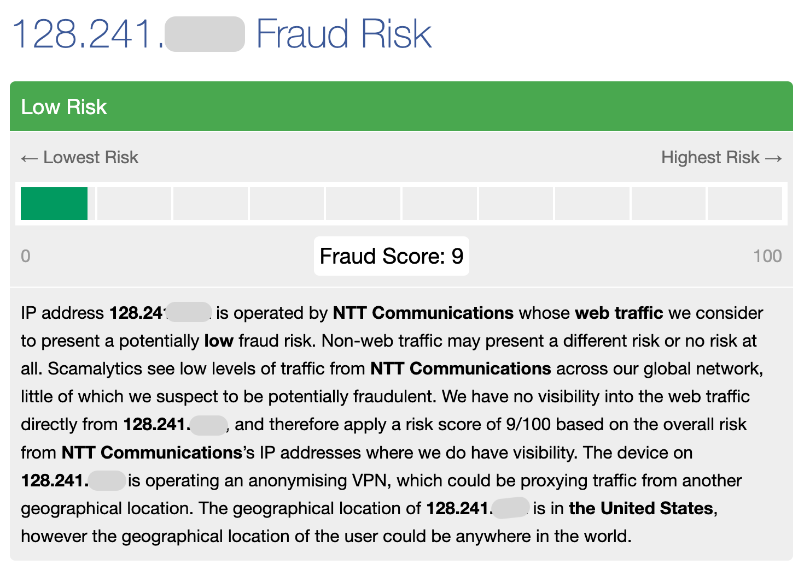
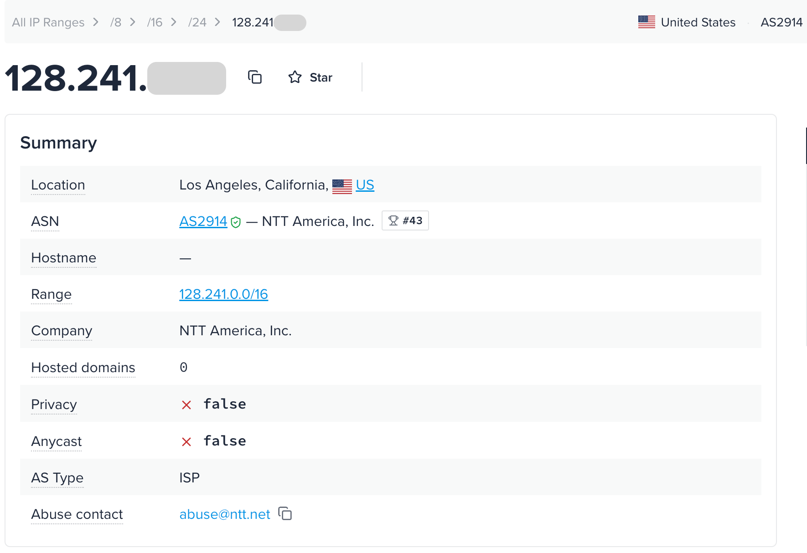

# Scamalytics 与 ipinfo 检测报告解读：你的第二个复核来源

> **适合谁读**：已经看过 ping0 或 IPQS，想再找一个独立来源复核的人；需要核对 IP 类型、归属和地理信息的本地业务运营者与测试人员
> **读完你能**：看懂 Scamalytics 和 ipinfo 报告上的每个字段；知道它们各自适合复核什么；用一个真实案例走完"多平台交叉复核"的全过程
> **阅读时间**：约 15 分钟
> **系列位置**：第 07 篇 · 主线的"字段"部分

---

## 先说结论

- 想换个来源查历史信誉，可以看 Scamalytics 的 `Fraud Score`（0–100），再看 Spamhaus、Firehol 等 5 个公开黑名单有没有命中。
- 想核对这是什么网络、查出来在哪儿，可以看 ipinfo 的 ASN 类型（ASN 是自治系统编号）和地理信息。它也会显示有没有检出 VPN、代理、托管或住宅代理。
- 已经查过 ping0 或 IPQS 时，先挑出想确认的那一项，再决定用哪家复核。
- Scamalytics 页面注明，代理类标记由 IP2Proxy 提供。两家显示同一个代理标记时，只算同一条证据。
- 本文的案例里，ping0 显示「家庭宽带」，ipinfo 的 ASN 类型是 `ISP`（网络运营商），Scamalytics 却显示 `Server: Yes`。下面用原来的报告看看还能查什么。

---

## 一、为什么把这两个平台放在一起

看完 ping0 或 IPQS 后，最常见的问题是："我还该看哪个平台复核？"

| 你想复核的维度 | 推荐平台 | 原因 |
|---|---|---|
| ③ 历史信誉 | **Scamalytics** | 与 IPQS 数据来源不同，还汇总了多个公开黑名单 |
| ① 类型真实性、② 地理一致性 | **ipinfo** | ASN 类型、隐私识别和地理信息清晰，且是很多网站在后台调用的数据源之一 |
| ④ 独占性 | 两者都有"住宅代理"识别 | 可以看这个 IP 是否被识别为住宅代理网络的一部分 |

两者都提供免费的网页查询，也都提供 API。

---

## 二、Scamalytics 逐字段解读

*这张图展示的是评分摘要，IP 地址已部分遮挡，图中没有查询日期。页面给出 9 分，同时在说明里标记了匿名 VPN。风险分和代理标记要分开看。*

### 1. Fraud Score 与风险等级 ★★★

**是什么**：Scamalytics 的 `Fraud Score` 是 0–100。分数越高，它评估的风险越高。页面也会显示风险等级，比如 `Low Risk`。

Scamalytics 的网页没有公布分档细节。据其威胁情报集成文档，分档为：0–25 低风险、26–50 中风险、51–75 高风险、76–100 严重风险。

**打个比方**：另一家征信机构给的"信用分"，同样是越低越好。

**对你意味着什么**：
- 对静态住宅 IP，目标是低风险区间；
- 第三方资料提到，Scamalytics 的评分会参考 IP 所在子网、ASN 等更大范围的反馈。所以一个 IP 本身没有不良记录，也可能因为"邻居"而分数偏高。这是第三方说法，但提醒我们：**单个来源的分数偏高，要和其他来源一起看**；
- Scamalytics 的分数和 IPQS、ping0 的量表都不同，不能换算。

### 2. Operator（运营者信息） ★★

| 字段 | 含义 |
|---|---|
| Hostname | 主机名（反向解析结果），没有时显示 n/a |
| ASN | 自治系统编号 |
| ISP Name | 网络服务商名称 |
| Organization Name | 运营组织名称，可能与 ISP 不同 |
| Connection type | 连接类型，很多 IP 显示 n/a |

**对你意味着什么**：用来核对归属，和其他平台的 ASN、ISP 信息对照。Connection type 经常为空，不要据此判断类型。

### 3. Location（地理位置） ★★

**是什么**：国家、州 / 省、区县、城市、邮编、经纬度。页面标注其 IP 地址数据合作方为 DB-IP。

**对你意味着什么**：可以作为又一个地理库参与"多数一致"的判断。注意：它的城市可能和其他库略有不同（例如本文案例中显示的是紧邻洛杉矶市的东洛杉矶）。

### 4. Datacenter ★★

**是什么**：这个 IP 是否位于数据中心，取值为 Yes、No 或 Unknown。

**对你意味着什么**：`Yes` 表示 Scamalytics 标为数据中心。看到 `Unknown`，就记作待查，再用其他来源核对。

### 5. External Blacklists（外部黑名单） ★★★

**是什么**：这个 IP 是否出现在 5 个公开的黑名单 / 数据集中：

| 黑名单 | 简单理解 |
|---|---|
| Firehol | 汇总多个公开威胁 IP 列表的聚合黑名单 |
| IP2ProxyLite | IP2Proxy 的免费代理 IP 数据库 |
| IPsum | 按被多少个威胁列表收录来汇总的恶意 IP 列表 |
| Spamhaus | 知名的反垃圾邮件与恶意网络黑名单 |
| X4Bnet Spambot | 垃圾邮件机器人 IP 列表 |

**打个比方**：就像查一个人是否上了几个公开的"黑名单"。

**对你意味着什么**：
- 静态住宅 IP 理想情况下应全部为 No；
- 命中 Spamhaus、Firehol、IPsum 这类威胁列表，说明这个 IP 曾被用于恶意活动，对账号类业务应按红灯处理；
- 命中 IP2ProxyLite，说明它被识别为代理，属于独占性 / 类型方面的信号。

### 6. Proxies（代理类标记） ★★

**是什么**：一组是 / 否标记：Anonymizing VPN（匿名 VPN）、Tor Exit Node（Tor 出口节点）、Server（服务器）、Public Proxy（公共代理）、Web Proxy（网页代理）、Search Engine Robot（搜索引擎爬虫）。页面注明，代理数据由 IP2Proxy 提供。

**对你意味着什么**：
- VPN、Tor、Public Proxy、Web Proxy 为 Yes，对静态住宅 IP 都是明显的负面信号；
- Scamalytics 的公开页面没有交代 `Server` 是怎么标的。IP2Proxy 的用途分类里，`DCH` 包括数据中心、网站托管和传输网络。两者可能有关，具体怎么对应，公开资料还没说清楚；
- 因为数据来自 IP2Proxy，**Scamalytics 和 IP2Proxy 在这些标记上结论相同，不算两个独立来源**。

### 7. Residential Proxy（住宅代理） ★★★

**是什么**：这个 IP 是否属于某个住宅代理网络。

**打个比方**：不是问"你是不是住宅"，而是问"你是不是被拿来当代理出租的住宅"。

**对你意味着什么**：`Yes` 表示 Scamalytics 认为这个 IP 属于住宅代理网络。买之前先看团队对这一项有没有要求，再按约定判断。

### 8. Scamalytics 经验判读区间

| 字段 | 🟢 绿灯 | 🟡 黄灯 | 🔴 红灯 |
|---|---|---|---|
| Fraud Score | 低风险（0–25） | 中风险（26–50） | 高风险及以上（> 50） |
| 外部黑名单 | 全部未命中 | 仅命中 IP2ProxyLite | 命中 Spamhaus、Firehol、IPsum 等威胁列表 |
| VPN / Tor / Public Proxy / Web Proxy | 全部为 No | — | 任一为 Yes |
| Server / Datacenter | 两项都显示 No | 有一项显示 Unknown，或只有 Server 显示 Yes，先换个来源核对 | 多个来源都标为机房 |
| Residential Proxy | No | — | Yes（账号类业务） |

以上为经验值，不是 Scamalytics 的官方标准。

---

## 三、ipinfo 逐字段解读

*这张图用来对照 ipinfo 的摘要字段，IP 地址已部分遮挡，图中没有查询日期。*

ipinfo 的网页查询会展示较完整的信息；免费 API 返回基础字段（IP、主机名、城市、地区、国家、经纬度、组织、邮编、时区），隐私识别等字段需要相应的付费数据。

### 1. 基础与地理字段 ★★

| 字段 | 含义 |
|---|---|
| hostname | 主机名（反向解析结果） |
| city / region / country | 城市、州 / 省、国家 |
| postal | 邮编 |
| loc | 经纬度 |
| timezone | 时区 |
| org | ASN 编号与名称（例如 "AS 编号 + 公司名"） |

**对你意味着什么**：ipinfo 是参与"多数一致"判断的主流地理库之一。时区可以用来核对设备的时区设置是否与 IP 一致。

### 2. ASN 类型（AS Type） ★★★

**是什么**：ipinfo 给这个 ASN 标的网络类型。常见的有 `ISP`（网络运营商）、`Hosting`（托管）、`Business`（企业）和 `Education`（教育）。

**打个比方**：这不是看"这个人在哪上班"，而是看"他所在的公司是做什么的"。

**对你意味着什么**：
- 静态住宅 IP 理想情况下为 ISP；Hosting 说明所属网络以托管业务为主，和住宅的预期不符；
- ipinfo 这项说的是这个网络属于哪一类。ping0 的「IP 类型」按它对网段用途的判断来标。两边查出来不一样，见第 04 篇的冲突案例。

### 3. Route / Range（路由与网段） ★★

**是什么**：这个 IP 所在的路由前缀（例如某个 /18）以及网段范围。

**对你意味着什么**：代运营机构批量采购时，可以用它辅助判断多个 IP 是否属于同一个网络段（第 10 篇）。

### 4. Privacy / Anonymization（隐私识别） ★★★

**是什么**：一组识别结果：VPN、Proxy（代理）、Tor、Relay（中继，例如某些浏览器的隐私中继服务）、Hosting（托管）、Residential Proxy（住宅代理）。如果识别到相关服务，有时会显示服务商名称。

**对你意味着什么**：
- 静态住宅 IP 理想情况下应全部为"未检出"；
- **Hosting 检出**：说明 ipinfo 认为这是托管 / 数据中心 IP，和住宅预期不符；
- **Residential Proxy 检出**：说明它被识别为住宅代理网络的一部分。对账号类业务，这是需要重视的信号。

### 5. Company（公司） ★

**是什么**：IP 所属的公司名称及类型。

**对你意味着什么**：辅助核对归属，通常与 ASN 所有者一致或相关。

### 6. Abuse contact（滥用联系人） ★

**是什么**：这个网段的滥用投诉联系方式。

**对你意味着什么**：普通用户一般用不到。可以帮助判断网段由哪个组织管理。

### 7. Hosted domains（托管的域名） ★★

**是什么**：解析到这个 IP 的域名。

**对你意味着什么**：住宅 IP 一般不会托管大量网站。如果一个 IP 上托管了很多域名，它很可能是服务器，而不是住宅 IP。

### 8. Anycast ★

**是什么**：是否为任播地址（同一个 IP 在多个地点同时宣告，常见于公共 DNS、CDN）。

**对你意味着什么**：住宅 IP 不应是任播地址。如果显示为任播，说明它不是你以为的住宅 IP。

### 9. ipinfo 经验判读区间

| 字段 | 🟢 绿灯 | 🟡 黄灯 | 🔴 红灯 |
|---|---|---|---|
| ASN 类型 | ISP | Business、Education（视业务） | Hosting，且其他平台多数也判为机房 |
| VPN / Proxy / Tor / Relay | 全部未检出 | — | 任一检出 |
| Hosting | 未检出 | — | 检出 |
| Residential Proxy | 未检出 | — | 检出（账号类业务） |
| 地理 | 与其他主流库多数一致 | 城市有差异但在同一都市圈 | 国家不一致 |
| Hosted domains / Anycast | 无 / 否 | — | 托管大量域名 / 任播 |

以上为经验值，不是 ipinfo 的官方标准。

---

## 四、实战：同一个 IP 的多平台交叉复核

下面用一个真实 IP（已脱敏为 207.55.x.x）走完一次完整的交叉复核。

### 第 1 步：收集各平台结果

| 维度 | ping0（2026-11-09） | ipinfo（2026-11-11） | Scamalytics（2026-11-11） |
|---|---|---|---|
| 地理 | 美国 / 加州 / 洛杉矶，置信度满格 | 美国 / 加州 / 洛杉矶，邮编 90022 | 美国 / 加州 / 东洛杉矶 |
| 类型 | 家庭宽带 | ASN 类型：ISP；托管未检出 | Datacenter：Unknown；**Server：Yes** |
| 信誉 | 风控值 1%（极度纯净） | — | Fraud Score 9（低风险）；5 个黑名单均未命中 |
| 独占 | 共享人数 1–10 | VPN、代理、Tor、中继、住宅代理均未检出 | VPN、Tor、公共代理、网页代理、住宅代理均为 No |
| 原生 / 广播 | 原生 IP | — | — |

*这张 ping0 图用来对照字段，页面显示的探测时间与上表不同。案例判断按上表的记录来做。*

*这张图用来对照 `fraud_score`、`proxy` 和 `recent_abuse`。图中地址已部分遮挡，无法和上表的案例地址核对，因此这份结果单独看。*

### 第 2 步：逐维判断

| 维度 | 判断 | 灯 |
|---|---|---|
| ② 地理一致性 | 三个平台都在洛杉矶都市圈内，国家一致；原生 IP | 🟢 |
| ③ 历史信誉 | ping0 和 Scamalytics 两个独立来源都显示低风险，无黑名单命中 | 🟢 |
| ④ 独占性 | ping0「共享人数」显示 1–10，ipinfo 和 Scamalytics 都未检出代理。要确认独享，还得看购买条款 | 🟢（已查项目） |
| ① 类型真实性 | ping0 显示「家庭宽带」，ipinfo 的 ASN 类型是 `ISP` 且未检出托管，Scamalytics 显示 `Server: Yes` | 🟡 |

### 第 3 步：查清分歧的原因

唯一的分歧是 Scamalytics 的 "Server: Yes"。我们做了两项核查：

1. **查同一网段的相邻 IP**。我们又查了同一 `/24` 网段里的另一个 IP。它也显示 `Server: Yes`、`Fraud Score` 9 和 `Datacenter: Unknown`；
2. **查标记的数据来源**。Scamalytics 的代理类标记由 IP2Proxy 提供。IP2Proxy 的用途分类里，`DCH` 包括数据中心、网站托管和传输网络。Scamalytics 有没有用这一类来标 `Server`，公开资料还没说清楚。

目前只能确认这两个地址查到的结果相同。这个标记是按单个 IP 还是按网段给出的，还需要更多证据。类型这一项先记黄灯。

### 第 4 步：下结论

- **整体**。地理、历史信誉和独占性已查到的项目是绿灯，类型先记黄灯；
- **对账号类业务**。如果你的采购标准允许这一项黄灯，可以把它留作候选，再补齐还没查的项目；
- **如果你的团队或客户以 Scamalytics / IP2Proxy 为主要依据**，先确认约定的标准能不能接受 `Server: Yes`；
- **最后一步**：补充 IPQS 的结果，并查看 ping0 的 ASN / 企业 / 注册地历史表，确认长期稳定性。

把各家报告显示的结果分别记下来。买之前，再确认这项分歧会不会影响你和团队约定的标准。

---

## 五、复核流程速查

1. 用 ping0 或 IPQS 做第一轮检测（第 05、06 篇）；
2. 用 **Scamalytics** 复核信誉：看分数、黑名单、代理类标记；
3. 用 **ipinfo** 复核类型与归属：看 ASN 类型、隐私识别、地理信息；
4. 出现分歧时，先查两项字段各自说的是什么、有没有用同一个来源。原因还没查清，就把分歧记下来。
5. 按第 04 篇的红黄绿灯方法下结论，并记录日期。

---

## 六、按业务场景：重点看哪些字段

| 人群 | Scamalytics 重点 | ipinfo 重点 |
|---|---|---|
| A 海外社媒账号长期运营者 | 黑名单、Residential Proxy | 隐私识别（尤其住宅代理、托管） |
| B 跨境电商店铺运营者 | Fraud Score、黑名单 | ASN 类型、国家 / 州 |
| D 广告账户运营与投放团队 | Fraud Score、黑名单 | 隐私识别 |
| C 面向特定城市的本地业务运营者 | 地理（作为又一个地理库参考） | 城市、邮编、时区 |
| E 代运营机构、海外虚拟助理团队 | 代理类标记（批量检查） | ASN、Route / Range（看网段分布） |
| F 固定地区的长期功能验证人员 | — | 城市、ASN 类型（每次测试记录） |

---

## 常见问题

**Q：Scamalytics 显示 "Server: Yes"，这个 IP 还能用吗？**
先看看其他检测站怎么标。如果只有 Scamalytics 显示 `Server: Yes`，类型这一项先记黄灯，按团队的采购要求决定。如果多个来源都标为机房，再按红灯处理。

**Q：Scamalytics 和 IPQS，哪个更准？**
没有更准的说法。两者数据来源不同，适合互相复核。一个偏高、一个正常时，看有没有近期滥用记录和黑名单命中。

**Q：ipinfo 显示 ASN 类型是 ISP，是不是就说明是家庭宽带？**
网络运营商也可能提供企业专线和机房业务。可以先看 ping0 的「IP 类型」。一定要买真实家宽时，再请卖家说清出口接在哪里。

**Q：ipinfo 显示检出了 Residential Proxy，怎么办？**
这说明 ipinfo 把这个 IP 标为住宅代理。如果团队买之前约定这一项要显示「未检出」，就按约定要求更换。

---

## 下一步读什么

- [第 05 篇：ping0 检测报告逐字段解读](05-ping0-field-guide.md)
- [第 06 篇：IPQualityScore 检测报告逐字段解读](06-ipqualityscore-field-guide.md)
- [第 04 篇：检测平台全景](04-ip-checker-platforms.md)——交叉验证与红黄绿灯
- [第 09 篇](09-scenarios-accounts-stores.md)、[第 10 篇](10-scenarios-regions-teams.md)：按业务场景判断

---

> 本文是《静态住宅 IP 选购指南》系列的第 07 篇，由 [GetIPProxy](https://getipproxy.com/zh-cn/) 团队编写。文中第三方平台的字段说明以各平台官方页面为准，案例中的真实检测数据采集于 2026-11-09 至 2026-11-11，检测数据会随时间变化。

**参考资料**
- [Scamalytics IP 查询页](https://scamalytics.com/ip/)
- [Scamalytics 威胁情报集成文档（ThreatQ）](https://helpcenter.threatq.com/assets/PDFs/Integrations/Scamalytics_Action_Guide_v1.0.0.pdf)
- [IP2Proxy 数据库说明（代理类型与用途分类）](https://www.ip2location.com/database/px11-ip-proxytype-country-region-city-isp-domain-usagetype-asn-lastseen-threat-residential-provider/)
- [ipinfo IP 查询页](https://ipinfo.io/)
